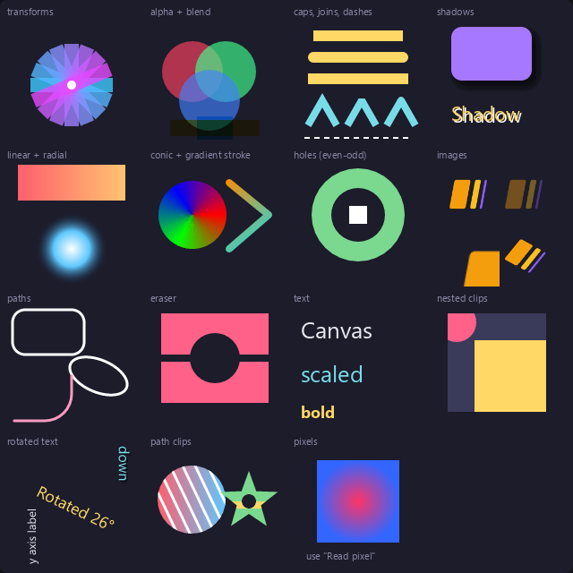

# canvas-lab

The 2D canvas, end to end. The left canvas is a grid of small drawings, one per feature; the right one is a freehand pen.



What each cell shows:

| Cell | Feature |
| --- | --- |
| transforms | `translate` / `rotate` / `scale`, `save` / `restore` |
| alpha + blend | `globalAlpha` and `globalCompositeOperation` (multiply, screen, ...) |
| caps, joins, dashes | `lineCap`, `lineJoin`, `setLineDash` |
| shadows | `shadowBlur`, `shadowOffset`, shadowed text |
| linear + radial, conic + gradient stroke | `createLinearGradient`, `createRadialGradient`, `createConicGradient` |
| holes (even-odd) | shapes with holes |
| images | `loadImage` and `drawImage` with source rectangles and alpha |
| paths | `roundRect`, `ellipse`, `arcTo`, curves |
| eraser | `destination-out` |
| text, rotated text | `fillText` at a size, bold, rotated and mirrored under a transform |
| nested clips, path clips | `pushClip` and `clip()` to a path |
| pixels | `getImageData` ("Read pixel"), `toBlob`, export to PNG |

The pen takes every position the mouse passed through in a frame (`onPointerMove`'s `points`), with pointer capture, and smooths them with a curve through the midpoints.

Run it from this folder:

```
glyx dev
GLYX_ENGINE=quickjs glyx dev       # the QuickJS engine
GLYX_RENDER=direct2d glyx dev      # the Direct2D renderer
```

The screenshot is the lab canvas as the app draws it: `await __canvasLab.lab.toPNG()` in the DevTools console, or `Automation.screenshot` on the canvas.
